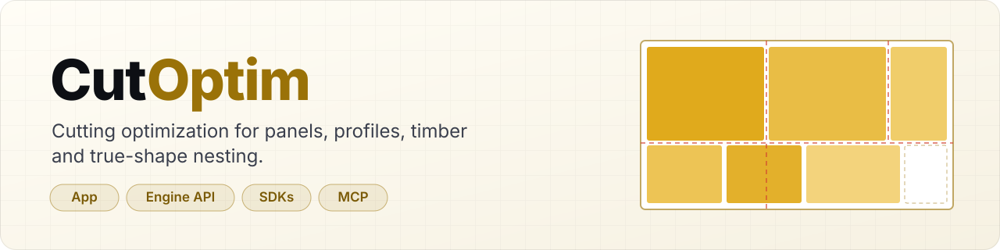

<p align="center">
  <a href="https://cutoptim.com">
    <picture>
      <source media="(prefers-color-scheme: dark)" srcset="./assets/banner-dark.svg">
      
    </picture>
  </a>
</p>

<p align="center">
  <a href="https://www.npmjs.com/package/@cutoptim/engine"></a>
  <a href="https://pypi.org/project/cutoptim/"></a>
  <a href="https://packagist.org/packages/cutoptim/engine"></a>
  <a href="https://cutoptim.com/engine/openapi.json"></a>
  <a href="https://cutoptim.com/engine/reference/guides/mcp"></a>
  <a href="https://stats.uptimerobot.com/ZemJicOm3b"></a>
</p>

<p align="center">
  <a href="https://cutoptim.com/app"><b>Open the app</b></a> ·
  <a href="https://cutoptim.com/engine/reference/quickstart"><b>API quickstart</b></a> ·
  <a href="https://cutoptim.com/engine/reference">API reference</a> ·
  <a href="https://cutoptim.com/engine/reference/changelog">Changelog</a> ·
  <a href="https://stats.uptimerobot.com/ZemJicOm3b">Status</a>
</p>

---

**CutOptim** turns a parts list into a cutting plan: which part goes on which board, where, and in what cut order — for
sheet goods, bars and profiles, timber cross-sections and free-form shapes. Use it in the browser, or call the same
engine from your own software.

## What we build

| | |
|---|---|
| 🪚 **[CutOptim app](https://cutoptim.com/app)** | Cutting optimizer in the browser: **2D sheets** (with grain, edge banding and matched sets), **1D bars and profiles**, **timber** by cross-section and **true-shape nesting** from SVG/DXF. Cutting plans, labels, PDF, DXF and Excel exports. 10 languages, free to start. |
| ⚙️ **[Engine API](https://cutoptim.com/engine)** | The same engines over HTTPS (`api.cutoptim.com`). Deterministic plans, saw-ready cut sequences, an async `max` engine, webhooks, `Idempotency-Key` retries and free validation endpoints. Described by an [OpenAPI 3.1](https://cutoptim.com/engine/openapi.json) document. |
| 📦 **Official SDKs** | Typed clients generated from the contract, with `waitForJob`, webhook verification and safe retries built in — [TypeScript](https://github.com/cutoptim/engine-js) · [Python](https://github.com/cutoptim/engine-python) · [PHP](https://github.com/cutoptim/engine-php). |
| 🤖 **[MCP server](https://cutoptim.com/engine/reference/guides/mcp)** | `https://api.cutoptim.com/mcp` — let Claude, Cursor or any MCP client plan cuts with the Engine API tools. |

## Start in a minute

Get a free **test key** (`co_test_…`, never billed) on your [dashboard](https://cutoptim.com/dashboard#api-keys), then:

```bash
curl https://api.cutoptim.com/v1/optimize/2d \
  -H "Authorization: Bearer $CUTOPTIM_KEY" \
  -H "Content-Type: application/json" \
  -d '{"parts":[{"name":"Side","w":720,"h":560,"qty":2}],"stock":[{"w":2800,"h":2070}],"options":{"kerf":4}}'
```

<details>
<summary><b>TypeScript</b> — <code>npm install @cutoptim/engine</code></summary>

```ts
import { CutOptim } from '@cutoptim/engine';

const client = new CutOptim({ apiKey: process.env.CUTOPTIM_KEY });
const plan = await client.optimize2d({
  parts: [{ name: 'Side', w: 720, h: 560, qty: 2 }],
  stock: [{ w: 2800, h: 2070 }],
  options: { kerf: 4 },
});
```
</details>

<details>
<summary><b>Python</b> — <code>pip install cutoptim</code></summary>

```python
import os
from cutoptim import CutOptim

client = CutOptim(api_key=os.environ["CUTOPTIM_KEY"])
plan = client.optimize_2d({
    "parts": [{"name": "Side", "w": 720, "h": 560, "qty": 2}],
    "stock": [{"w": 2800, "h": 2070}],
    "options": {"kerf": 4},
})
```
</details>

<details>
<summary><b>PHP</b> — <code>composer require cutoptim/engine</code></summary>

```php
use CutOptim\Engine\Client;

$client = new Client(getenv('CUTOPTIM_KEY'));
$plan = $client->optimize2d([
    'parts' => [['name' => 'Side', 'w' => 720, 'h' => 560, 'qty' => 2]],
    'stock' => [['w' => 2800, 'h' => 2070]],
    'options' => ['kerf' => 4],
]);
```
</details>

<details>
<summary><b>MCP</b> — Claude Code, Cursor, Claude Desktop</summary>

```bash
claude mcp add --transport http cutoptim https://api.cutoptim.com/mcp \
  --header "Authorization: Bearer $CUTOPTIM_KEY"
```

Cursor, Claude Desktop and the public demo key (try it without an account): see the [MCP guide](https://cutoptim.com/engine/reference/guides/mcp).
</details>

## Resources

- 📘 [API reference](https://cutoptim.com/engine/reference) · [Quickstart](https://cutoptim.com/engine/reference/quickstart) · [Guides](https://cutoptim.com/engine/reference/guides/sheet-2d) · [Errors](https://cutoptim.com/engine/reference/errors) · [Limits](https://cutoptim.com/engine/reference/limits)
- 🧾 [OpenAPI 3.1](https://cutoptim.com/engine/openapi.json) · [Postman collection](https://cutoptim.com/engine/postman.json) · [API changelog](https://cutoptim.com/engine/reference/changelog)
- 🟢 [Status page](https://stats.uptimerobot.com/ZemJicOm3b) · 🤖 [`llms.txt`](https://cutoptim.com/llms.txt)
- 🔐 Security reports: [security@cutoptim.com](mailto:security@cutoptim.com) — see our [disclosure policy](https://cutoptim.com/security#vulnerability-disclosure)
- ✉️ Everything else: [support@cutoptim.com](mailto:support@cutoptim.com)

<sub>The SDKs are MIT-licensed and published from our main repository; each SDK repository here is a read-only mirror — please report bugs and requests as issues there.</sub>
